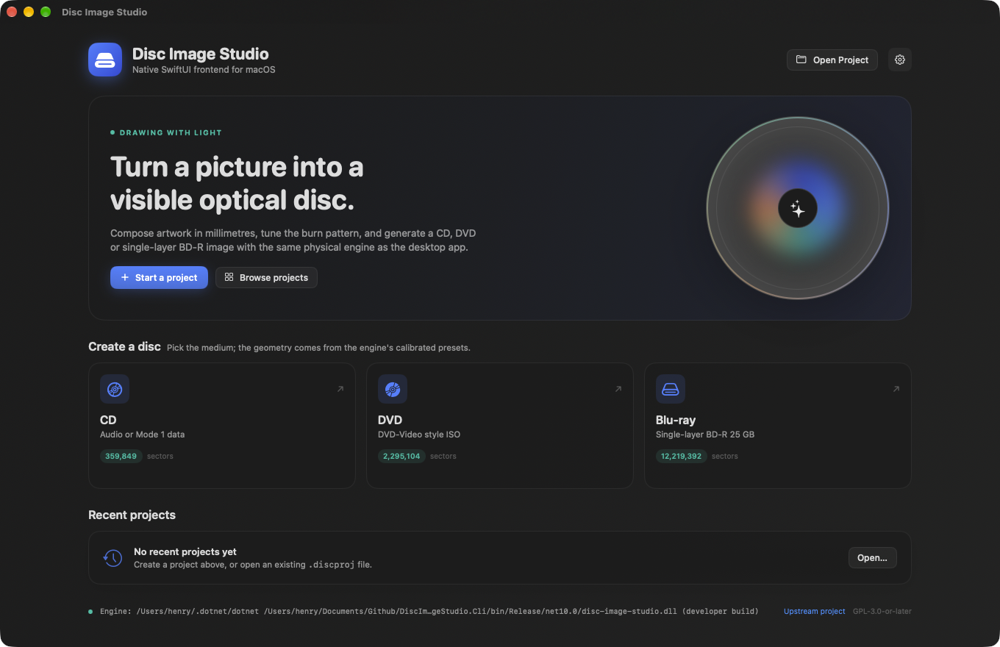
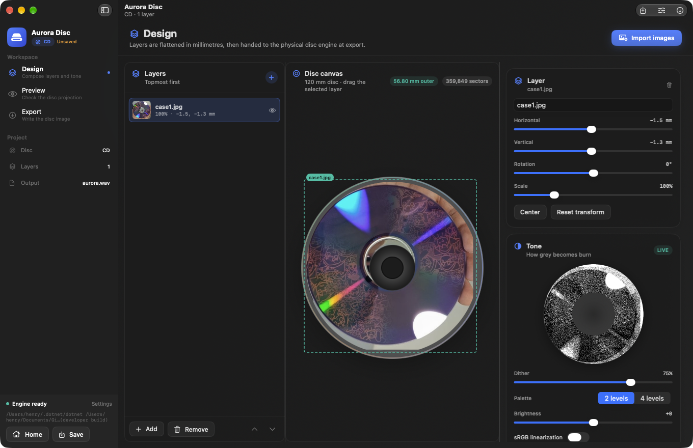

# Disc Image Studio — native macOS frontend

A native SwiftUI macOS workspace for [DiscImageStudio](https://github.com/JiaFeiMiao-K-Cat/DiscImageStudio).
The UI, layer compositor, tone preview, project editor and `.discproj` reader/writer are
Swift; the mature physical CD/DVD/BD-R encoders stay in the upstream .NET engine and are
driven through its cross-platform CLI.





## Why this exists

The upstream desktop app is WPF and Windows-only. The engine already ships an experimental
Linux/macOS CLI, so this frontend gives macOS a first-class native window:

- **Design** — import PNG/JPEG/BMP/GIF/TIFF/HEIC layers by picker or drag-and-drop, place them
  in millimetres, rotate/scale, and see the live tone projection.
- **Preview** — asks the engine to render the real CD/DVD geometry projection or read back an
  already generated artifact. Blu-ray uses the native tone projection (there is no standalone
  BD preview command upstream).
- **Export** — generates CD WAV/CUE, CD data ISO, DVD ISO or single-layer BD-R ISO through the
  same engine, including hybrid disc folders and the experimental DVD read-compatibility mode.
- **Projects** — reads and writes upstream `.discproj` schema 2, including tone and Blu-ray
  polarity settings, so a project can move between the Windows app and this frontend.

## Requirements

- macOS 14 or newer (Apple Silicon or Intel).
- Xcode 15+ with the macOS SDK, or the command-line tools plus a matching Swift toolchain.
- XcodeGen is optional; the generated `DiscImageStudioMac.xcodeproj` is committed.
- .NET 10 SDK to build/run the engine. The app can also bundle a self-contained engine so an
  end user does not need .NET installed.

## Build and run

From the repository root:

```bash
# 1. Build the cross-platform engine (framework-dependent is enough for development).
dotnet build src/DiscImageStudio.Cli/DiscImageStudio.Cli.csproj -c Release

# 2. Build the native app. The script finds Xcode even when xcode-select points at CLT.
macos/scripts/build-app.sh

# 3. Launch it.
open "macos/build/Build/Products/Debug/Disc Image Studio.app"
```

The app discovers the engine in this order:

1. `DIS_IMAGE_STUDIO_CLI` environment variable
2. the path chosen in **Settings → Engine**
3. `Contents/Resources/cli/disc-image-studio` inside the app bundle
4. the developer build under `src/DiscImageStudio.Cli/bin/{Release,Debug}/net10.0/`
5. Homebrew / user install / `PATH`

If you build the app with the engine bundled, the app is self-contained apart from macOS:

```bash
BUNDLE_CLI=self-contained macos/scripts/build-app.sh
# or BUNDLE_CLI=framework when .NET 10 is installed on the target Mac
```

`build-cli.sh` publishes just the engine to `macos/build/cli`:

```bash
macos/scripts/build-cli.sh
```

## Verify

```bash
# 22 unit tests, including tiny CD, DVD and BD-R generations through the .NET CLI.
cd macos
DEVELOPER_DIR=/Applications/Xcode.app/Contents/Developer \
  xcodebuild -project DiscImageStudioMac.xcodeproj -scheme DiscImageStudioMac \
  -derivedDataPath build CODE_SIGNING_ALLOWED=NO test

# Ask the upstream C# ProjectJsonStore to load a project written by Swift.
macos/scripts/verify-project-compat.sh
```

The integration tests render native composites, build the engine argument vectors, and generate a tiny CD WAV/CUE, DVD ISO and BD-R ISO. The compatibility script uses the upstream
`ProjectJsonStore.Load` implementation, not a reimplementation.

## Layout

```text
macos/
├── project.yml                     XcodeGen specification
├── DiscImageStudioMac.xcodeproj    Generated Xcode project
├── scripts/                        build, CLI publish, compatibility check
└── DiscImageStudioMac/
    ├── Kit/Models/                 .discproj schema 2, family, tone, presets
    ├── Kit/Services/               project store, compositor, CLI runner, commands
    ├── Kit/ViewModels/             workspace state and orchestration
    ├── App/Views/                  SwiftUI screens
    ├── Resources/                  app icon and Info.plist
    └── Tests/                      XCTest unit + engine integration tests
```

### Rendering split

- `DesignRenderer` implements the same square-composite convention as the WPF
  `DesignComposer`: the square centre is the disc centre and its side spans
  `2 × contentOuterRadiusMm`. Layers are stored topmost-first and painted bottom-up.
- The tone preview ports `ToneProfile`'s brightness/gamma/hash-dither math so the design card
  matches the engine's look.
- Export hands the 8192 px composite to the CLI. The engine applies the final tone mapping,
  ECC/EFM and filesystem layout.

## Current scope

Implemented: project create/open/save/save-as, recent projects, family presets, geometry
validation, layer stack editing, drag/drop import, direct canvas drag + magnification,
tone controls, native design/tone previews, CD/DVD engine previews, artifact read-back,
CD/DVD/BD export, hybrid disc folders, volume labels, cancellation, engine diagnostics,
Settings and About.

Deliberately not included yet:

- **Disc burning** — the upstream burning layer is Windows IMAPI2. Generate an image on macOS
  and burn with your preferred tool.
- **Calibration workspace** — calibration photos/records remain in the Windows app for now.
- **Exact DVD/BD custom-usable-sector image scaling** — the CLI maps the picture over the full
  geometry; built-in presets use full geometry, and CD supports `--usable-sectors` natively.

## License

GPL-3.0-or-later, same as upstream. See `../LICENSE` and the upstream
[third-party notices](../THIRD-PARTY-NOTICES.txt). The app icon is derived from the upstream
project asset.
